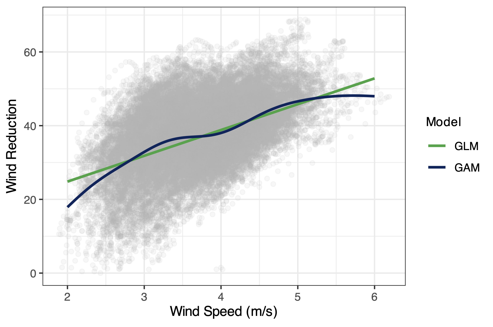

::: {.cgm-home}

::: {.cgm-hero}

::: {.cgm-lab-name}
Computational Geomorphology and Modeling Lab
:::

::: {.cgm-hero-copy}

# Landscapes.\
# Data.\
# [Discovery.]{.cgm-discovery}

::: {.cgm-lead}
Geomorphology and data science, brought together to investigate environmental processes and change.
:::

We connect field observations, spatial data, statistics, and computational models to ask how landscapes work—and what their patterns can tell us.

::: {.cgm-actions}
[Explore our research ↗](research.qmd){.cgm-button}
[Meet the lab](people.qmd){.cgm-button .cgm-button-outline}
:::

:::

::: {.cgm-visual}

::: {.cgm-visual-top}
OBSERVE / ANALYZE / DISCOVER
:::

{.cgm-hero-image fig-alt=""}

::: {.cgm-visual-caption}
From observations to understanding  
:::

:::

:::

::: {.cgm-ribbon}
[Geomorphology]{.cgm-ribbon-item}
[Data science]{.cgm-ribbon-item}
[Statistical modeling]{.cgm-ribbon-item}
[Spatial analysis]{.cgm-ribbon-item}
[Field research]{.cgm-ribbon-item}
:::

::: {.cgm-section}

::: {.cgm-section-heading}
[Our approach]{.cgm-eyebrow}

## Curiosity in the field. Insight in the data.
:::

::: {.cgm-intro}
The Computational Geomorphology and Modeling Lab brings together geomorphology and data science to investigate environmental processes and change, with a major research focus on coastal and aeolian systems. We combine field measurements, LiDAR, UAS-derived surfaces, and terrestrial laser scanning to document environmental conditions and landform morphology across space and time.

Using R and GIS, we develop reproducible workflows for data management, visualization, and spatial analysis. Inferential statistics, machine learning, and time-series analysis help us examine patterns, test hypotheses, explore nonlinear relationships, assess uncertainty, and evaluate model performance. We connect these findings to environmental processes and management questions, communicating both what the evidence supports and its limitations.
:::

:::

::: {.cgm-research-section}

::: {.cgm-section-heading}
[Research in motion]{.cgm-eyebrow}

## Different questions. Connected ways of thinking.

Explore the systems we study and the analytical approaches we bring to them.
:::

::: {.cgm-cards}

::: {.cgm-card .cgm-card-green}
[01 / EARTH SYSTEMS]{.cgm-card-number}

### Landforms & sediment movement

Beach–dune morphodynamics, aeolian transport, and the environmental drivers of geomorphic change.

:::

::: {.cgm-card .cgm-card-blue}
[02 / DATA & MODELS]{.cgm-card-number}

### Patterns & predictions

Statistical modeling, spatial analysis, machine learning, and time series to understand complex environmental datasets.

:::

::: {.cgm-card .cgm-card-sand}
[03 / ENVIRONMENTAL APPLICATIONS]{.cgm-card-number}

### Habitats & natural infrastructure

Sea turtle nesting habitat and beach wrack research connecting environmental patterns with management questions.

:::

:::

:::

::: {.cgm-community}

::: {.cgm-community-copy}
[Learn. Collaborate. Investigate.]{.cgm-eyebrow}

## Your next question could start here.

We welcome motivated undergraduate and graduate students interested in geomorphology, data science, statistical modeling, and field-based environmental research.

Students build skills in data collection, coding, quantitative reasoning, and interpreting environmental datasets.

::: {.cgm-actions}
[Get in touch ↗](people.qmd){.cgm-button}
:::

:::

::: {.cgm-community-note}
[Curiosity]{.cgm-curiosity}

### Bring your questions. Build your skills.

Field notebooks and code notebooks both belong here.

:::

:::

:::
