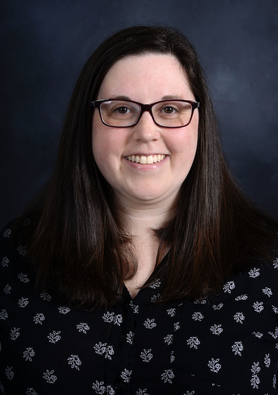
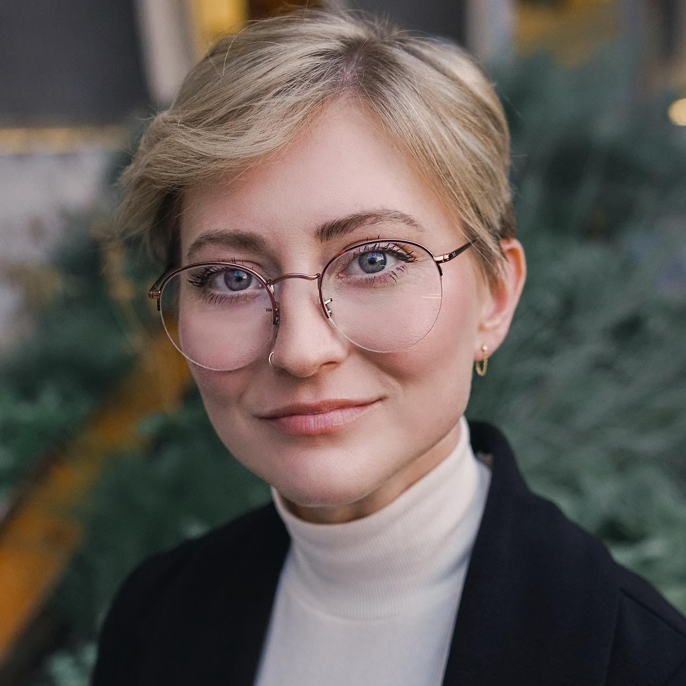
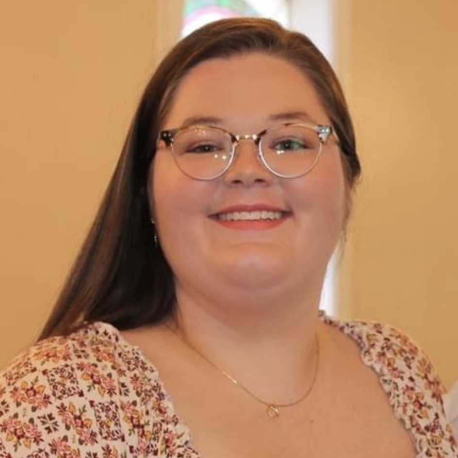
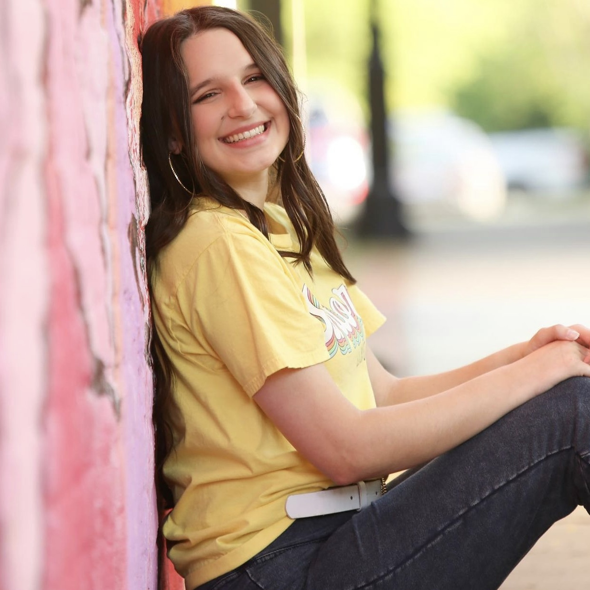

::: {.cgm-page}

::: {.cgm-page-hero}

Meet the CGM Lab

# Our People

Geomorphology, mathematics, statistics, and data science come together through our people.

:::

::: {.cgm-page-body}

:::: {.cgm-people-section}

## Lab Co-Directors

::: {.cgm-people-grid}

::: {.cgm-director-card}

::: {.cgm-director-photo}

{.cgm-director-image fig-alt="Portrait of Phillip Schmutz"}

:::

::: {.cgm-director-copy}

### Phillip Schmutz, PhD

Associate Professor  
Department of Earth & Environmental Sciences  
University of West Florida

::: {.cgm-actions}

[Faculty website ↗](https://phillipschmutz.github.io){.cgm-button}
[Email](mailto:pschmutz@uwf.edu){.cgm-button .cgm-button-outline}

:::

:::

:::

::: {.cgm-director-card}

::: {.cgm-director-photo}

{.cgm-director-image fig-alt="Image for Samantha Seals"}

:::

::: {.cgm-director-copy}

### Samantha Seals, PhD

Associate Professor  
Department of Mathematics and Statistics  
University of West Florida

::: {.cgm-actions}

[Faculty website ↗](https://sealslab.github.io){.cgm-button}
[Email](mailto:sseals@uwf.edu){.cgm-button .cgm-button-outline}

:::

:::

:::

:::

::::

:::: {.cgm-people-section}

## Graduate Research Students

::: {.cgm-student-grid}

::: {.cgm-person-card}

::: {.cgm-student-copy}

### Gabby Westerfield

Earth and Environmental Sciences

[Wrack as Natural Infrastructure: Elevation Change, Sediment Trapping, and Public Perceptions](wrack.qmd)

::: {.cgm-actions}

[Email](mailto:glw37@students.uwf.edu){.cgm-button .cgm-button-outline}

:::

:::

::: {.cgm-student-photo}

{.cgm-student-image fig-alt="Penguin placeholder image"}

:::

:::

::: {.cgm-person-card}

::: {.cgm-student-copy}

### Maggie Darbyshire

Earth and Environmental Sciences

[Ecogeomorphic Controls on Coastal Dune Morphology Across Managed and Unmanaged Shorelines](eco-geo-dunes.qmd)

::: {.cgm-actions}

[Email](mailto:mmd59@students.uwf.edu){.cgm-button .cgm-button-outline}

:::

:::

::: {.cgm-student-photo}

{.cgm-student-image fig-alt="Penguin placeholder image"}

:::

:::

::: {.cgm-person-card}

::: {.cgm-student-copy}

### Rachel Hudson

Mathematics and Statistics

[A Time Series Analysis on Nesting Habits of Loggerhead Sea Turtle](turtles.qmd)

::: {.cgm-actions}

[Email](mailto:rak7@students.uwf.edu){.cgm-button .cgm-button-outline}

:::

:::

::: {.cgm-student-photo}

{.cgm-student-image fig-alt="Penguin placeholder image"}

:::

:::

::: {.cgm-person-card}

::: {.cgm-student-copy}

### Audrey Moore

Mathematics and Statistics

In development

::: {.cgm-actions}

[Email](mailto:alm109@students.uwf.edu){.cgm-button .cgm-button-outline}

:::

:::

::: {.cgm-student-photo}

{.cgm-student-image fig-alt="Portrait of Audrey Moore"}

:::

:::

::: {.cgm-person-card}

::: {.cgm-student-copy}

### Cheyenne Long

Mathematics and Statistics

In development

::: {.cgm-actions}

[Email](mailto:){.cgm-button .cgm-button-outline}

:::

:::

::: {.cgm-student-photo}

{.cgm-student-image fig-alt="Portrait of Cheyenne Long"}

:::

:::

::: {.cgm-person-card}

::: {.cgm-student-copy}

### Angelina Scamardo

Mathematics and Statistics

In development

::: {.cgm-actions}

[Email](mailto:ams270@students.uwf.edu){.cgm-button .cgm-button-outline}

:::

:::

::: {.cgm-student-photo}

{.cgm-student-image fig-alt="Portrait of Angelina Scamardo"}

:::

:::

:::

::::

:::: {.cgm-people-section}

## Undergraduate Research Students

::: {.cgm-student-grid}

::: {.cgm-person-card}

::: {.cgm-student-copy}

### Lucia Dillersberger

Earth and Environmental Sciences

Accuracy of RTK vs PPK GPS Data Collection Methods for Drone-Based Dune Research

::: {.cgm-actions}

[Email](mailto:lcd13@students.uwf.edu){.cgm-button .cgm-button-outline}

:::

:::

::: {.cgm-student-photo}

{.cgm-student-image fig-alt="Penguin placeholder image"}

:::

:::

::: {.cgm-person-card}

::: {.cgm-student-copy}

### Gabby Beemer

Earth and Environmental Sciences

[From Disturbance to Recovery: Long-Term Vegetation Response to Dune Trampling](trampling.qmd)

::: {.cgm-actions}

[Email](mailto:gb91@students.uwf.edu){.cgm-button .cgm-button-outline}

:::

:::

::: {.cgm-student-photo}

{.cgm-student-image fig-alt="Penguin placeholder image"}

:::

:::

:::

::::

:::: {.cgm-people-section .cgm-alumni}

## Alumni
### Graduate Students

| Name | Year | Program |Thesis/Capstone | Current Position |
|----------|----|-----|------------------------------|-----------------|
| Halie Weatherington | 2026 | EES | Comparative Analysis of Pseudo-Absence Statistical Ratios in Relation to Sea Turtle Nesting Preferences | CEI Inspector @ Metric Engineering |
| Divina Cox | 2024 | EES | Examine the Influnece of Beach Morphology on Sea Turtle Nesting Behavior in the Years 2010, 2016, and 2020 on Santa Rosa Island and Perdido Key, FL | Ph.D. Student @ UC Santa Barbara |
| Shijie Geng | 2024 | Data Science |  |  |
| Madison Williams | 2022 | EES | The Spatial Variability of Sea Turtle Nest Sites Related to Beach Geomorphology Characteristics on Pensacola Beach and Gulf Islands National Seashore, FL | Restoration Coordinator for the Panhandle Dune Ecosystem Project - FWC |
| Marley Allen | 2019 | EES | Influence of Sand Fence Configuration on Sand Accumulation and Wind Flow | Ph.D Student @ the University of New Orleans |

### Undergraduate Students
| Name | Year | Program |Thesis/Capstone | Current Position |
|----------|----|-----|------------------------------|-----------------|
| Angelina Scamardo | 2026 | Math/Stats | Machine Learning Approaches to Model Sea Turtle Nesting: A Comparison of Random Forest and Support Vector Machine Models | Graduate Student in Statistics @ UWF |
| Dru Adams | 2026 | Math/Stats | Frequentist vs. Bayesian Models of Sea Turtle Nest Site Selection Across Nesting Seasons |  |
| Joe Agin | 2025 | EES | Evaluating the Influence of Beach Wrack on Near-Surface Aerodynamics and Sediment Transport Processes | Project Scientists @ PPM Consultants, Inc |
| Cheyenne Long | 2025 | Math/Stats |  | Graduate Student in Mathematics @ UWF |
| Hunter Evans | 2023 | Math/Stats |  |  |

::::

:::

:::
